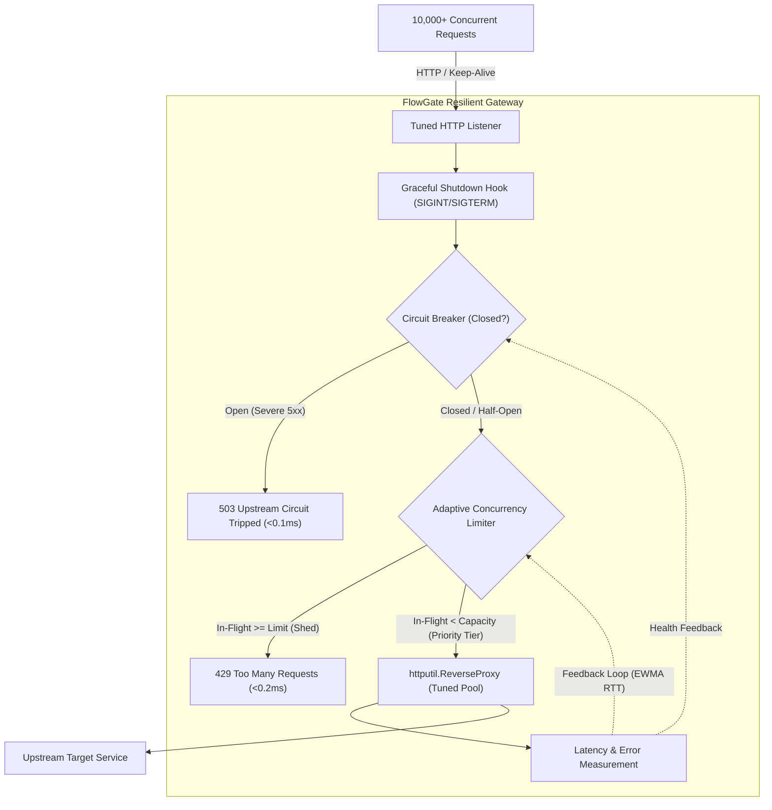

# FlowGate 🛡️

[](https://github.com/No-man1234/FlowGate/actions)
[](https://golang.org)
[](LICENSE)

**FlowGate** is a high-concurrency, self-tuning resilient reverse proxy and API gateway written in Go. 

Unlike traditional gateways (NGINX, Kong, Envoy) that rely on static, human-configured rate limits (`max_connections = 500`), FlowGate acts as an autonomous shock absorber. It uses **control theory** (Netflix Gradient / TCP Vegas congestion control) to continuously probe backend round-trip time ($RTT$) and dynamically adjust in-flight request capacity in real time.

When upstream services experience queueing or brownouts, FlowGate instantly sheds excess traffic with sub-millisecond fast-fail responses (`429 Too Many Requests` / `503 Service Unavailable`), protecting the backend from catastrophic failure while keeping $p95$ latencies pristine.

---

## Architecture & System Design



---

## Core Capabilities

### 1. Adaptive Concurrency Limiting (The Brain)
FlowGate implements the **Gradient Limit Algorithm** (based on Little's Law and TCP Vegas):

$$\text{Gradient} = \min\left(\text{Tolerance}, \frac{RTT_{\text{min}}}{RTT_{\text{sample}}}\right)$$

$$\text{Limit}_{\text{next}} = \text{Limit}_{\text{current}} \times \text{Gradient} + \sqrt{\text{Limit}_{\text{current}}}$$

* **$RTT_{\text{min}}$**: Minimum observed baseline latency when the system is healthy.
* **$RTT_{\text{sample}}$**: Exponentially Weighted Moving Average (EWMA) of current latency.
* When upstream latency climbs (queueing formed), $\text{Gradient} < 1.0$, automatically shrinking the concurrency limit.
* When latency stabilizes, FlowGate gently probes upward for extra capacity.

### 2. Priority-Tiered Load Shedding
When capacity contracts, FlowGate does not reject requests indiscriminately. It uses tiered headroom:

* **Critical (`X-Priority: critical`)**: Allowed up to 100% capacity (payments, authentication, checkout).
* **Standard (`X-Priority: standard`)**: Allowed up to 85% capacity (normal browsing, search).
* **Best-Effort (`X-Priority: best-effort`)**: Shed first when in-flight reaches 70% capacity (analytics, webhooks, prefetching).

### 3. Fast-Fail Circuit Breaker
If an upstream service suffers repeated crashes ($5\text{xx}$ errors or network timeouts), the circuit breaker trips `OPEN`, rejecting traffic in **$< 0.1\text{ms}$** without touching the upstream network stack. After a cooldown window, it shifts to `HALF-OPEN` to safely probe recovery.

### 4. Zero-Allocation Lock-Free Telemetry
Counters and rate tracking rely entirely on Go's `sync/atomic` primitives and cache-line aligned structures, ensuring the gateway adds $< 0.2\text{ms}$ of overhead even under tens of thousands of requests per second.

### 5. Graceful Drain & Zero-Downtime Shutdown
Traps `SIGINT` and `SIGTERM`, instantly halts acceptance of new connections, and grants in-flight requests a graceful drain deadline before process termination.

---

## Directory Structure

```
.
├── .github/workflows/ci.yml # Automated CI verification pipeline
├── cmd/
│   ├── flowgate/            # Main gateway server with live dashboard
│   ├── upstream/            # Simulated backend with controllable chaos endpoints
│   └── loadgen/             # High-concurrency benchmark tool
├── pkg/
│   ├── breaker/             # Fast-fail 3-state Circuit Breaker
│   ├── limiter/             # Gradient adaptive concurrency limiter
│   ├── metrics/             # Lock-free atomic metrics & terminal dashboard
│   ├── proxy/               # Reverse proxy with tuned connection pooling
│   └── server/              # Graceful shutdown lifecycle management
├── Makefile
├── go.mod
└── README.md
```

---

## Quickstart

### Prerequisites
* Go 1.23+

### 1. Clone & Build
```bash
git clone https://github.com/No-man1234/FlowGate.git
cd FlowGate
go build -o bin/ ./cmd/...
```

### 2. Run the Mock Upstream Server
Simulates a backend service with a baseline latency of 15ms that degrades if overloaded beyond 50 concurrent requests:
```bash
go run ./cmd/upstream -port 9090 -latency 15 -capacity 50
```

### 3. Launch FlowGate
Starts the resilient gateway on port `8080`, proxying traffic to the upstream service with the live dashboard enabled:
```bash
go run ./cmd/flowgate -port 8080 -upstream http://127.0.0.1:9090
```

```text
======================================================================
 [FlowGate] Resilient Gateway Status                           
======================================================================
 Upstream Circuit : HEALTHY [CLOSED]      In-Flight: 48 / 52 (Limit)
 Traffic Inflow   : 4,820.0 req/sec       Min RTT  : 14.80 ms
 Shedding Rate    : 2,340.0 req/sec       SampleRTT: 18.20 ms
 Total Handled    : 48,200                Total Shed: 23,400 (48.5%)
 Upstream 5xx     : 0                     Breaker Trips: 0
======================================================================
```

### 4. Run the Chaos Benchmark
Fire 500 concurrent workers sending a mix of Critical, Standard, and Best-Effort requests:
```bash
go run ./cmd/loadgen -url http://127.0.0.1:8080/work -concurrency 500 -duration 10s
```

You can also dynamically inject chaos into the upstream server in another terminal:
```bash
# Inject a 300ms latency spike for 10 seconds:
curl "http://127.0.0.1:9090/chaos/spike?duration=10s&latency=300ms"

# Inject 50% simulated database panics:
curl "http://127.0.0.1:9090/chaos/error?rate=0.5"

# Reset chaos:
curl "http://127.0.0.1:9090/chaos/reset"
```

Watch FlowGate contract its concurrency limits in real-time, protect the backend from dying, and recover automatically!

---

## Endpoints

| Endpoint | Method | Description |
| :--- | :--- | :--- |
| `/*` | `ANY` | Reverse-proxied through the resilient pipeline to the upstream. |
| `/metrics` | `GET` | Instantaneous JSON snapshot of system metrics, RTT, and limit state. |
| `/healthz` | `GET` | Health check endpoint returning `200 OK`. |

---

## Testing

Run unit tests with Go's data race detector:
```bash
go test -v -race -cover ./...
```

---

## License

This project is licensed under the [MIT License](LICENSE).
