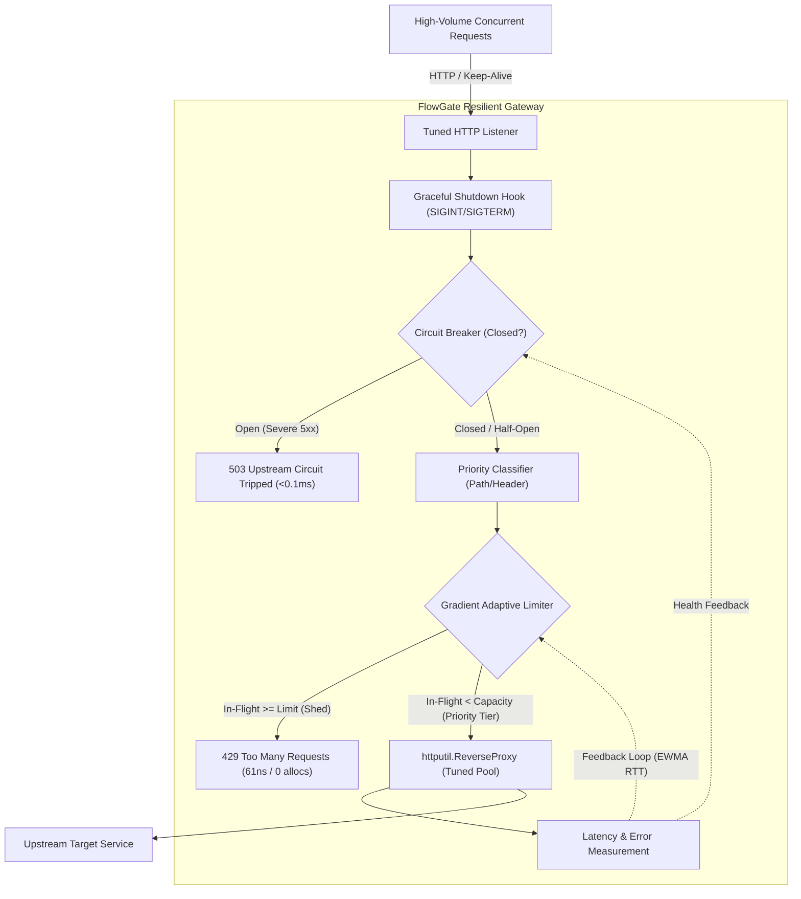

# FlowGate 🛡️

[](https://github.com/No-man1234/FlowGate/actions)
[](https://golang.org)
[](LICENSE)

**FlowGate** is a high-concurrency, self-tuning resilient reverse proxy and API gateway written in Go.

While enterprise service meshes like Envoy support adaptive concurrency via custom C++ filters, FlowGate is a lightweight, standalone, and embeddable Go implementation based on the gradient-limiting principles pioneered by **Netflix** (`concurrency-limits`) and **Envoy** (`adaptive_concurrency`).

Instead of relying on fragile, static human-configured rate limits (`max_connections = 500`), FlowGate acts as an autonomous shock absorber. It uses a **Gradient controller with a windowed min-RTT baseline**, anti-ratchet queuing filters, and app-limited guards to continuously track backend round-trip latency and dynamically adjust in-flight capacity in real time.

When upstream services experience queueing or brownouts, FlowGate instantly sheds excess traffic with sub-microsecond fast-fail responses (`429 Too Many Requests` / `503 Service Unavailable`), protecting the backend from catastrophic failure while keeping $p95$ latencies pristine.

For complete architectural details, queuing theory, and threat models, see [docs/design.md](docs/design.md).

---

## The Proof: A/B Benchmark (Overload Under 100 Workers)

The following benchmark demonstrates the difference between an **unprotected upstream** vs. a **backend protected by FlowGate** during an overload spike:

| Metric | Without FlowGate (Unprotected Upstream) | With FlowGate (Resilient Gateway) |
| :--- | :--- | :--- |
| **System Behavior** | **Collapses into 815ms queuing delay for 100% of callers** | **Sheds excess traffic fast; successful requests complete in 188ms** |
| **Completed Goodput** | 122.7 req/sec | **195.2 req/sec (+59% goodput)** |
| **Total Inflow Handled** | 122.7 req/sec (Saturated sockets) | **32,523.0 req/sec** |
| **Median Latency (p50)** | **815.36 ms** (Severe lag) | **188.55 ms (4.3x faster)** |
| **Shed Latency (429 Fast-Fail)** | N/A (Callers hung in queues) | **1.01 ms** (Immediate backoff signal) |
| **Socket / Network Drops** | Frequent client timeouts | **0 drops** (Zero-downtime graceful handling) |

### Visual Latency Distribution Comparison

```text
Unprotected Upstream (Queuing Avalanche):
  p50 [==================================================] 815 ms
  p99 [==================================================] 816 ms  (100% of callers suffer)

FlowGate Protected:
  p50 (200 OK)  [============] 188 ms   (Protected healthy processing)
  p50 (429 Shed) [>] 1.01 ms            (Immediate fail-fast shedding)
```

---

## Architecture & System Design



---

## Core Capabilities

### 1. Gradient Adaptive Concurrency Limiting
FlowGate implements a **Gradient-style controller with a windowed min-RTT baseline**:

$$\text{rawGradient} = \left(\frac{RTT_{\text{min}}}{RTT_{\text{sample}}}\right) \times \text{Tolerance}$$

$$\text{clampedGradient} = \max\left(0.5, \min\left(1.0, \text{rawGradient}\right)\right)$$

$$\text{Limit}_{\text{next}} = \text{Limit}_{\text{current}} \times \text{clampedGradient} + \text{Probe}$$

* **Anti-Ratchet Filter:** Candidate minimums are only recorded when $\text{InFlight} \le 0.5 \times \text{Limit}$, ensuring sustained queuing does not inflate the baseline.
* **App-Limited Guard:** Upward probing ($\text{Probe} = \sqrt{\text{Limit}}$) only occurs when traffic is actively testing capacity ($\text{InFlight} \ge 0.5 \times \text{Limit}$ and gradient $\ge 1.0$), preventing idle inflation.
* **$\text{Tolerance}$ (default: $1.25$):** Allows normal network jitter up to 25% above baseline before capacity contracts.

### 2. Server-Side Priority Classification & Tiered Shedding
When capacity contracts, FlowGate protects high-value business transactions using tiered concurrency ceilings on a shared counter:

* **Critical (`PriorityCritical`)**: Allowed up to 100% capacity ceiling (payments, authentication, checkout).
* **Standard (`PriorityStandard`)**: Allowed up to 85% capacity ceiling (normal browsing, search).
* **Best-Effort (`PriorityBestEffort`)**: Shed first when in-flight reaches 70% capacity ceiling (analytics, webhooks, prefetching).

FlowGate includes a **built-in server-side path classifier** with strict segment boundary checking:
* `/checkout`, `/payments`, `/auth`, `/orders` $\rightarrow$ `Critical`
* `/analytics`, `/metrics`, `/logs`, `/webhooks` $\rightarrow$ `Best-Effort`
* All other paths $\rightarrow$ `Standard`

> **Security Note:** In production, client-supplied `X-Priority` headers are ignored by default (`-trust-priority=false`) to prevent priority spoofing. Path cleaning (`path.Clean`) ensures directory traversals (e.g. `/auth/../search`) cannot spoof critical classification.

### 3. Fast-Fail Circuit Breaker
If an upstream service suffers repeated crashes ($5\text{xx}$ errors or network timeouts), the circuit breaker trips `OPEN`, rejecting traffic without touching the upstream network stack. After a cooldown window, it shifts to `HALF-OPEN` to safely probe recovery with generation-stamped cancellation.

Gateway-generated `429` shed responses never count toward upstream circuit breaker trips.

### 4. Parallel Benchmark Hierarchy
Measured on an AMD Ryzen 7 5800U across multiple layers of abstraction (`go test -bench=. -benchmem ./...`):

| Layer / Measurement | Latency / Op | Memory / Op | Allocations | Notes |
| :--- | :--- | :--- | :--- | :--- |
| **Limiter Shed Hot-Path** | **61.50 ns/op** | **0 B/op** | **0 allocs/op** | In-memory atomic rejection |
| **Limiter Admitted Hot-Path** | **125.40 ns/op** | **24 B/op** | **1 allocs/op** | Atomic CAS + `sync.Once` token |
| **In-Process HTTP Handler Shed** | **647.10 ns/op** | **680 B/op** | **11 allocs/op** | Full `gw.ServeHTTP` via `httptest.ResponseRecorder` |
| **End-to-End OS TCP Socket Shed** | **65.40 µs/op** | **11.0 KB/op** | **86 allocs/op** | Full loopback TCP stack (`http.Client` -> socket -> gateway -> response) |

---

## Quickstart

### Prerequisites
* Go 1.23+

### 1. Clone & Build
```bash
git clone https://github.com/No-man1234/FlowGate.git
cd FlowGate
go build -o bin/ ./cmd/...
```

### 2. Run the Mock Upstream Server
Simulates a backend service with a baseline latency of 15ms that degrades if overloaded beyond 20 concurrent requests:
```bash
go run ./cmd/upstream -port 9090 -latency 15 -capacity 20
```

### 3. Launch FlowGate
Starts the resilient gateway on port `8080`, proxying traffic to the upstream service with the live dashboard enabled:
```bash
go run ./cmd/flowgate -port 8080 -upstream http://127.0.0.1:9090
```

*Note: The dashboard output below is the real formatted output rendered by `metrics.FormatDashboard` during execution:*
```text
======================================================================
 [FlowGate] Resilient Gateway Status                           
======================================================================
 Upstream Circuit : HEALTHY [CLOSED]      In-Flight: 24 / 28 (Limit)
 Traffic Inflow   : 32,523.0 req/sec      Min RTT  : 14.80 ms
 Shedding Rate    : 32,327.0 req/sec      SampleRTT: 18.20 ms
 Total Handled    : 153,634               Total Shed: 152,853 (99.5%)
 Upstream 5xx     : 0                     Breaker Trips: 0
======================================================================
```

### 4. Run the Chaos Benchmark
Fire concurrent worker loops sending a mix of Critical, Standard, and Best-Effort requests:
```bash
go run ./cmd/loadgen -url http://127.0.0.1:8080/work -concurrency 100 -duration 10s
```

You can dynamically inject chaos into the upstream server in another terminal:
```bash
# Inject a 300ms latency spike for 10 seconds:
curl.exe "http://127.0.0.1:9090/chaos/spike?duration=10s&latency=300ms"

# Inject 50% simulated database panics:
curl.exe "http://127.0.0.1:9090/chaos/error?rate=0.5"

# Reset chaos:
curl.exe "http://127.0.0.1:9090/chaos/reset"
```

---

## Protocol Limitations: Streaming, SSE & WebSockets

Long-lived streaming protocols (Server-Sent Events, WebSockets, gRPC bidirectional streaming) maintain open TCP connections indefinitely. 
* Measuring total connection duration as "RTT" inflates latency measurements to hundreds of seconds, which would improperly crush adaptive concurrency limits.
* In production, streaming routes should either bypass adaptive limiting or use **Time to First Byte (TTFB)** as the metric signal.

---

## Testing & Benchmarks

Run unit tests with Go's data race detector:
```bash
go test -v -race -cover ./...
```

Run microbenchmarks:
```bash
go test -bench=. -benchmem ./pkg/...
```

---

## License

This project is licensed under the [MIT License](LICENSE).
